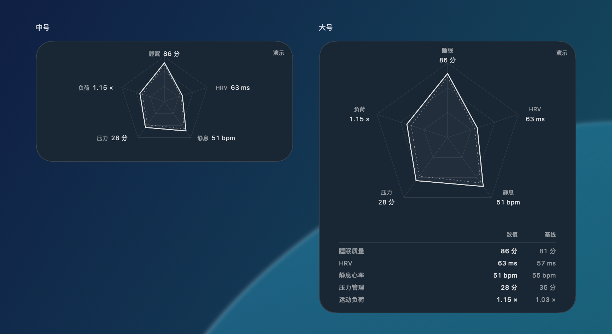

# Recover Radar

一个用 **Swift、SwiftUI 和 WidgetKit** 构建的原生 macOS 睡眠与恢复桌面小组件。数据通过 [COROS MCP](https://github.com/coroslab/COROS-MCP) 读取，无第三方依赖，不需要大语言模型或中间服务器。

雷达图展示睡眠质量、HRV、静息心率、压力管理、运动负荷，并与过去 30 个完整日的个人基线比较。

> **当前版本：0.2.0-preview.1（预发布）。** 已实现原生 OAuth / PKCE、Keychain、MCP 读取、五指标解析、90 日历史、30 日基线、逐项缓存状态、菜单栏和小组件代码。已有 COROS 连接上的只读查询验证了数据形态；**本应用的真实账号登录、完整签名与桌面小组件安装仍待验收**。演示数据始终标记为“演示”。

## 下载与预览

[GitHub Releases](https://github.com/AnpingWhale/recover-radar/releases) 提供 Apple Silicon（M 系列）预览包，要求 macOS 14+。下载 DMG，打开后将应用拖入 Applications。该包仅作主应用与布局体验：**未经过 Developer ID 签名或 Apple 公证，不包含桌面 Widget 扩展**，macOS 可能阻止打开；也可按下方步骤自行从源码构建。不要关闭系统安全保护。



*布局参考图，数据为合成演示。不透明离屏渲染不展示原生 Liquid Glass；实际玻璃效果请在 macOS 26+ 打开应用的“小组件效果”画廊。*

Release 中另有带 `with-Widget-UNSIGNED-universal` 的开发包，包含真正的主应用和 Widget 扩展（arm64 + x86_64）；它未签名、未配置授权 App Group，**不能当作普通用户安装包**。完整工程已通过 [Xcode Release 构建与 85 项测试](https://github.com/AnpingWhale/recover-radar/actions/runs/41183691448)。发布内容、构建方式和正式发行的剩余条件见 [发布指南](docs/RELEASING.md)。

## 环境与运行

- macOS 14+（支持桌面小组件）。
- Xcode 16+，Swift 6；Command Line Tools 也可构建独立主应用预览。原生 Liquid Glass 预览需要 Xcode 26+ 或配套的 Swift 6.2+ / macOS 26 SDK；旧工具链使用系统材质。
- 运行完整小组件需要为两个 target 配置同一 Apple Developer Team 与 App Group。无账号签名的核心测试不受影响。

```sh
# 验证算法、缓存、协议、认证和同步
./Scripts/test.sh

# 仅使用 Command Line Tools 构建并打开本地主应用预览
./Scripts/build-preview.sh
open 'build/Recovery Radar Preview.app'

# 用完整 Xcode 打开 app + widget extension
open RecoverRadar.xcodeproj
```

预览版支持演示、连接和同步，使用独立凭证及私有缓存，**不安装桌面小组件**。应用根据本机时区自动配置，直接点击连接，在默认浏览器中授权；成功后读取当天及前 30 日。真实授权流程需要用户本人完成。

正式工程的签名与安装步骤见 [开发指南](docs/DEVELOPMENT.md)。主应用运行时约每小时同步，回到窗口时按需更新；可以启用菜单栏或登录启动。应用退出后不会继续获取远程数据，小组件仍显示已保存的快照及过期状态。

点击主窗口的“查看桌面小组件效果”可打开中号 / 大号、浅色 / 深色视觉预览。macOS 26+ 上，使用新 SDK 构建的画廊采用原生 `glassEffect`；macOS 14 / 15 或旧工具链使用系统材质。减少透明度或增强对比度时，画廊使用不透明底色。它与扩展共用内容视图，仍不等于已安装到桌面。

真实桌面小组件适配 Apple Liquid Glass：透明或着色外观由 WidgetKit 提供，应用根据系统渲染模式调整全彩 / 单色内容，保留实线今日、虚线基线的区分。实际玻璃效果随系统设置、壁纸和辅助功能变化。[Apple 的小组件适配说明](https://developer.apple.com/documentation/widgetkit/optimizing-your-widget-for-accented-rendering-mode-and-liquid-glass)

单项查询失败时保留该项旧值与原读取时间；断开连接会清除本地凭证、历史与快照。解析只接受已经核对的英文日值报告，格式变化会明确报错，不猜测数值。

## 如何读图

- 实线是当天；虚线是近 30 天个人常态线，**不含当天**。
- 当天值与历史中位数使用相同固定刻度，基线形状随真实数值变化，不固定在 50。0–100 仅是显示刻度，不是 COROS 官方评分；范围见指标规范。
- 睡眠质量、HRV、运动负荷越高越向外；静息心率、压力越低越向外。**负荷向外代表更大负荷，图形面积不是恢复好坏或总分。**
- 每个指标保留原始值、单位、基线值及有效天数。历史不足 7 个有效日时不绘制该轴相对指数；缺失不补零。
- 当天未结束的数据单独标记，昨天的缓存不会改称今天。完整规则及限制见 [指标规范](docs/METRICS.md)。

## 项目结构

```text
Apps/
  RecoverRadar/               SwiftUI 主应用：连接、同步、菜单栏、设置
  RecoverRadarWidget/         WidgetKit 扩展：只读快照、时间线
Sources/
  RecoveryCore/               值模型、基线算法、隔离历史与快照存储
  RecoveryUI/                 App / Widget 共用的原生雷达图和视图
  COROSIntegration/           OAuth、HTTP / MCP、日值解析与同步协调
Tests/                       核心、认证、协议、解析和同步的合成测试
Scripts/                     不依赖完整 Xcode 的开发预览构建
Configuration/               公共构建设置及本地签名覆盖
RecoverRadar.xcodeproj/       已提交的 Xcode 工程，无需工程生成器
docs/                        架构、接入、指标、开发与决策记录
```

## 设计与维护

从 [技术架构](docs/ARCHITECTURE.md) 开始；随后阅读 [COROS 接入](docs/COROS_INTEGRATION.md)、[指标规范](docs/METRICS.md)、[实施路线](docs/ROADMAP.md) 和 [架构决策](docs/adr/0001-native-local-first.md)。

参与开发请看 [CONTRIBUTING](CONTRIBUTING.md)。隐私边界见 [SECURITY](SECURITY.md)。当前版本没有健康数据分析服务、遥测或个人数据上传功能。

本项目采用 [MIT License](LICENSE)，Copyright © 2026 AnpingWhale。COROS 名称及服务归其权利人所有，本项目不暗示官方背书。
