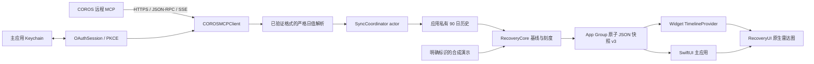

# 技术架构

更新日期：2026-10-30。COROS 原生认证、只读 MCP、生产解析、同步、私有历史和快照 v3 已实现；原生浏览器授权及签名后的小组件运行仍待验收。代码实现、平台连接上的数据验证和本机端到端验收是三种不同的证据，详见 [接入记录](COROS_INTEGRATION.md)。

## 目标与边界

Recover Radar 是 macOS 14+ 原生桌面小组件及其配套应用。使用 Swift 6、SwiftUI、WidgetKit 和 Apple 系统框架，无第三方 Swift 包，无 Python/Node 运行依赖，无模型调用，无自建后端。

主应用承担账号连接、同步、指标说明与诊断；小组件承担快速查看。首版支持中、大尺寸。应用只使用五项健康读取工具，不访问个人资料、运动路线或上传接口；没有健康数据遥测。

## 进程与数据流

MCP 是远程工具协议，不要求客户端使用 AI。本应用固定调用允许列表内的读取工具，以确定性规则计算图形。[MCP 工具协议](https://modelcontextprotocol.io/specification/2025-11-25/server/tools)

## 代码分层

| 模块 / 目录 | 职责 | 依赖边界 |
| --- | --- | --- |
| `RecoveryCore` | 日值、历史、快照、30 天窗口、显示刻度 | 仅 Foundation；不依赖 SwiftUI、WidgetKit、认证或服务 DTO |
| `RecoveryUI` | 雷达图、原始数值、覆盖天数、缺失和演示展示 | SwiftUI + Core；无网络、无磁盘写入 |
| `COROSIntegration/OAuth` | 区域发现、动态注册、系统浏览器授权、PKCE、Keychain、刷新和撤销 | Apple 系统框架；仅主应用链接 |
| `COROSIntegration/Transport` | 有界 HTTPS 请求、禁止重定向、超时和可取消读取 | Foundation；传输可注入测试 |
| `COROSIntegration/MCP` | 初始化、工具分页、输入 schema 校验、五项允许列表、JSON/SSE | 不执行服务端指令或任意工具 |
| `COROSIntegration/Health` | 日期窗口、严格英文报告解析、已确认日期范围 | 映射到 Core；不持久化原始响应 |
| `COROSIntegration/Sync` | 合并同步请求、逐轴失败处理、历史替换、生成快照 | 单一 coordinator 对应连接和时区 |
| `RecoverRadar` | 窗口与生命周期、连接入口、同步触发、App Group 写入及 Widget 重载 | Core + UI + Integration；唯一快照写入方 |
| `RecoverRadarWidget` | 快照读取、Timeline、占位和缓存错误展示 | Core + UI + WidgetKit；无凭证、认证模块或网络 entitlement |

根 Swift Package 承载共用模块与测试，Xcode 工程承载应用和扩展。工程显式引用本地 Package，确保单份源码，不需要 XcodeGen、CocoaPods、图表库或 MCP SDK。

## 认证与连接隔离

用户点击连接后，主应用先用 Network.framework 绑定 `127.0.0.1` 的随机可用端口，再通过 `NSWorkspace` 打开默认浏览器。公共客户端动态注册、授权请求和授权码交换使用同一个 `http://127.0.0.1:<port>/callback` URL；采用随机 `state` 和 PKCE `S256`。对 COROS 的所有远程请求仍使用所选区域的 HTTPS 端点，不跨区域发送令牌。

2026-10-30 的 CN 动态注册兼容性检查中，自定义 scheme `recoverradar://oauth/callback` 被服务以 HTTP 400 `invalid_redirect_uri` 拒绝，没有创建 OAuth 客户端。因此 OAuth 路径改用官方示例所采用的 loopback 方式；`recoverradar://dashboard` 仍用于从 Widget 打开主应用，不再承担授权回调。

回调服务仅监听 IPv4 loopback，先绑定再注册，避免其他进程抢占尚未绑定的端口。请求上限为 8 KiB，严格检查 GET、Host、路径、state 和重复安全参数；单连接有短超时，整个监听最多 5 分钟，成功、失败、超时及取消都会关闭监听。主应用因此启用 `network.server` entitlement；Widget 仍没有任何网络权限。随机端口注册及真实浏览器登录回跳仍需原生授权验收。

`OAuthSession` actor 合并刷新请求。令牌与刷新轮换结果一起持久化到主应用 Keychain，按区域存储；每次新的连接生成随机 UUID，用于本地历史隔离，不读取账号个人标识。正式签名版使用 Data Protection Keychain；显式 ad-hoc 预览使用独立 service 的本机 login Keychain，不在运行出错后自动切换。Widget 没有 Keychain sharing 或 OAuth 代码。

断开时先停止并等待同步结束，再清除本地凭证、私有历史和共享快照，重载 Widget。远端撤销属于尽力操作，网络失败不阻止本地删除；Keychain 删除失败必须明确报错。取消及连接代次检查防止晚到响应恢复旧连接。区域、连接或时区改变后重建同步上下文，并清除旧共享数据。

## 同步设计

1. 每轮先发现工具及其分页 schema。输入校验通过后，才调用五项允许的工具；工具描述和响应文本不会改变客户端能力。
2. 查询账号日期 D 及其前 30 日。睡眠采用显式日期范围；HRV 分成最多 7 个自然日的批次，避免不使用的原始序列过大；静息心率、压力、负荷使用 `days: 31`。
3. 五轴串行执行，限制请求量。多个同步触发共享同一进行中的任务；取消能够传递到请求与退避等待。
4. 每轴只有通过格式、字段、日期、单位和数值校验后，才更新本地历史。只替换报告**明确包含的日期**；明确的 `No data` 形成缺失修订，响应未提及的日不等于撤回，保留其旧历史。
5. 某轴失败不阻止其他轴成功。响应未确认今天时，本轴标记同步未完成，不能因更新了历史而宣称今天已更新。旧同日值可以保留，但必须保留其原时间并标记错误；昨天的数据不进入今天的当前值。
6. 快照原子写入成功后，主应用请求 Widget 重载。即使同步失败，仍可写入新的状态快照；`generatedAt` 表示文件生成时间，不能替代各轴的读取时间。

传输层对 GET/HEAD 和 MCP 允许列表中的只读请求实施有界重试；429 尊重 `Retry-After`，等待过长时交给后续同步。OAuth 注册、授权码交换和令牌刷新 POST 不自动重放。401 仅允许一次受控刷新后重试；刷新无法继续时要求重新连接。

主应用已接入连接、取消、手动同步、断开清理、菜单栏和 ServiceManagement 可选登录启动。启动时恢复连接并同步；回到前台后，距上次尝试至少 15 分钟才再次同步。运行中的定时检查每分钟执行，距上次尝试约 60 分钟后同步；失败也记录尝试时间，避免快速反复请求。

菜单栏开关方便用户保持进程运行，登录启动由用户主动选择。主应用完全退出后不会获取新数据；系统睡眠、网络和调度可能延迟执行，不承诺整点更新。真机登录项、唤醒和桌面行为仍需按 [路线图](ROADMAP.md) 验收。

WidgetKit 的刷新预算和执行时间由系统决定。Timeline 重新读取缓存，并在日界和过期阈值预排状态变化；这些刷新不会产生新的远程数据。[Apple：保持小组件更新](https://developer.apple.com/documentation/widgetkit/keeping-a-widget-up-to-date)

## 数据与存储

### 应用私有历史

`HealthHistoryStore` actor 在应用私有目录保存版本化 Codable JSON。`HistoryScope` 由随机连接 UUID、区域和显式时区组成；路径组件经过编码，文件内再次校验作用域。无需保存邮箱、姓名或远端账号 ID。

保留**今天及前 89 个自然日**，按当前本机时区的 Calendar 运算裁剪。主键是作用域内的指标和自然日；最新 `updatedAt` 修订覆盖旧值，相同时间保留先到记录。非法值修订及明确撤回都保留为 JSON `null`，撤回另有 `isMissing` 标记，防止迟到的旧值重新出现。日值载入、合并、替换均执行规范化，写入使用原子替换和受限文件权限。

当前文本报告没有提供稳定的来源修订时间，因此生产适配器的 `updatedAt` 是本次成功读取时间，不是测量时间，也不表示设备刚完成同步。未来接入真正的来源修订时间时，需要独立迁移该语义，不能混用两种排序时钟。

只保存规范化日值，不保存完整文本、日内 HRV 序列或睡眠轨迹。历史最大规模约数百条，暂不需要数据库；体量或查询复杂度显著增加后再评估 SwiftData。

### App Group 快照 v3

`RadarSnapshot` 只包含小组件需要的内容：

| 范围 | 字段及含义 |
| --- | --- |
| 快照 | `schemaVersion`、`generatedAt`、`day`、`timeZoneIdentifier`、五轴、`isDemo` |
| 连接与同步 | `connectionState`、`syncState`、`lastAttemptAt` |
| 每轴数值 | 当前原值、基线中位数、两个显示指数、有效日数、暂定标记 |
| 每轴时效与原因 | `observedDay`、`observedAt`、`availability`；原因是固定本地枚举 |

不包含令牌、完整历史、个人标识、服务错误原文或原始报告。演示快照始终 `isDemo == true`，且不声称已经连接。

`SnapshotStore` 使用 App Group 的 `RecoverRadar/radar-snapshot.json`。主应用是唯一写入方；Widget 只读。读取校验版本、时区、日期、轴序、数值范围、基线门槛和来源元数据；任何当前原值都必须带有效的观察日和时间。容器不可用、无文件、损坏及版本不兼容分别处理，不悄悄写入两个进程互不共享的私有目录。

v1 没有逐轴时效，v2 使用固定 50 的基线指数；v3 明确拒绝读取这两类旧快照，提示打开主应用重建。不会为旧快照发明来源时间，也不以演示值代替生产失败。

App Group 标识由两个 target 共用的构建配置提供。fork 后需要使用自己的唯一标识和同一 Team 完成授权；修改字符串不足以获得共享容器权限。[Apple：App Group 容器](https://developer.apple.com/documentation/xcode/accessing-app-group-containers)

## 时间、指标和展示状态

生产与演示日期均自动采用本机 `TimeZone.autoupdatingCurrent`，连接页不提供地区选择或时区输入。首次服务区域按时区标识推定：中国大陆时区使用 CN、欧洲及所列欧洲大西洋时区使用 EU、其他使用 US；这只是默认路由策略，不证明账号归属。已有授权始终绑定原区域，不因旅行跨区传递令牌。时区变化时停止旧同步、清除旧共享快照，在新时区作用域重新查询；不会重新解释旧历史。服务按账号日汇总的结果若与本机窗口不符，仍严格校验并标记该轴失败，不平移日期。睡眠使用报告所属日，不把它减一天当作入睡日。窗口与保留期均使用 Calendar 自然日运算；时区改变后重取日值，不重新解释旧日期。

基线为每轴过去 30 个完整日的中位数，最低需要 7 个有效日，缺失不补零。当天与基线中位数使用同一固定显示范围，基线指数随数值变化；它是个人近期常态线，不是 COROS 官方恢复分，也不输出综合分或训练建议。[指标规范](METRICS.md) 定义量纲和全部显示规则。

| 状态 | 行为 |
| --- | --- |
| 演示 | 明确标识合成数据，不显示已连接 |
| 无快照 | 引导打开主应用，画廊 placeholder 可使用明确标识的演示 |
| 部分数据 | 显示已有原值及 N/30 天，缺轴不补零、不闭合填充面积 |
| 可用 | 显示数据日及每轴最后成功读取时间 |
| 陈旧 | 数据日已变化、该轴读取超过 6 小时、时间明显位于未来或最近查询失败 |
| 格式 / 工具不支持 | 保留旧历史，使用固定本地原因，等待适配更新 |
| 需要重新连接 | 保留旧数值和其时间，在主应用处理认证 |
| 缓存错误 | 明示读取失败，不回退到合成数据 |

6 小时是展示策略，不是生理有效期；一个指标成功不会刷新其他指标的时间。跨日后旧快照可带日期显示为陈旧，但重建的新快照不能拿昨日值填入今日轴。

## 开发预览与正式应用

`Scripts/build-preview.sh` 可用 Command Line Tools 独立编译并 ad-hoc 签名主应用预览，输出 `build/Recovery Radar Preview.app`。预览明确标识为开发构建，可以用于 UI、连接和同步的后续本机测试，但不安装 Widget，也不模拟 App Group 权限。

预览使用单独的 bundle ID、Keychain service 和私有 `PreviewSnapshots` 目录；这是构建时明确选择的模式，不是正式应用在共享容器出错时的静默回退。预览禁用登录启动，主应用正式构建仍必须使用已授权的 App Group。完整 Xcode 缺失时，这条路径能提供可运行主窗口，不能证明扩展注册、沙盒签名或桌面小组件已通过验收。

## 验证与发布

- Core：自然日边界、DST、修订和撤回、90 日隔离存储、混合时效、快照验证与迁移拒绝。
- 集成单元测试：注入的传输、凭证及合成文本覆盖协议错误、取消、令牌轮换、解析和同步失败；不使用真实健康数据作 fixture。
- 已有远端证据：通过现有平台 COROS 连接观察五工具文本形态，以及本次每项 31 个日期的覆盖；这不是原生应用授权验收。
- 待验收：原生 loopback 随机端口注册、真账号浏览器授权及刷新、完整 Xcode 编译、签名安装、App Group 权限、小组件注册和真实桌面 UI。
- 发布前：完成区域兼容性、无障碍、签名与 notarization、隐私说明、许可证及维护渠道。CI 编译不替代实际签名运行。

阶段状态与后续门槛见 [路线图](ROADMAP.md)。

## 小组件视觉预览

`RecoveryWidgetContent` 位于 RecoveryUI，WidgetKit 扩展与应用内画廊共用这一份内容布局。`WidgetPreviewGallery` 展示中 / 大尺寸和浅 / 深色；示例外壳采用 360×170、360×382 点及 12 点内边距，仅为参考尺寸，实际尺寸、边距、着色和背景由 WidgetKit 管理。画廊始终使用标记为演示的合成数据，不声称注册或安装了桌面小组件。

真实 Widget 的 `RadarWidgetView` 读取 `widgetRenderingMode`，将 `fullColor` 映射为彩色内容，将 `accented` / `vibrant` 映射为单色内容。共享视图只接收 `monochrome` 展示参数，不引入 WidgetKit 依赖。今日曲线保持实线、基线保持虚线，数值、缺失状态和演示标记不依赖颜色表达。增强对比度时雷达网格和关键曲线加强对比与粗细。

扩展以 `containerBackground(for: .widget)` 声明背景，并显式允许移除。macOS 的透明或着色外观由 WidgetKit 替换为系统玻璃效果；扩展不另叠 `glassEffect`，也不强制用户使用某种桌面外观。系统仍负责边距、背景、透明度与着色合成。[Apple：Liquid Glass 与 accented 渲染](https://developer.apple.com/documentation/widgetkit/optimizing-your-widget-for-accented-rendering-mode-and-liquid-glass) · [小组件背景](https://developer.apple.com/documentation/widgetkit/displaying-the-right-widget-background)

应用画廊的外壳单独由 `WidgetGlassSurface` 管理：使用 Swift 6.2+ / macOS 26 SDK 编译且运行于 macOS 26+ 时，采用原生 `glassEffect`；两个卡片放入 `GlassEffectContainer`，容器合并距离小于卡片间距，避免静止时融合。Xcode 16 的旧编译器通过编译条件排除新 API，macOS 14 / 15 通过运行时条件回退到 `.regularMaterial`，最低部署版本不变。需要配套的编译器与 SDK，较新 Swift 编译器搭配旧 SDK 不属于原生玻璃的支持构建组合。[Apple：自定义 Liquid Glass](https://developer.apple.com/documentation/swiftui/applying-liquid-glass-to-custom-views)

画廊使用 `glassEffect(.clear)`，在受控壁纸上增加轻量暗底以保证白色数值的可读性；与 macOS 透明小组件一致，两种壁纸明暗下都显示单色白色内容。背景切换只用于比较壁纸对玻璃的影响，不修改系统外观。画廊检测减少透明度与增强对比度，在任一设置开启时改用不透明底色。真实 Widget 的外层辅助功能适配交由系统，内部雷达图仍响应增强对比度；两种运行上下文必须分别验收。画廊的背景为本地 SwiftUI 几何图形，不读取用户壁纸、不下载素材、不引入动画或额外依赖。

静态渲染脚本调用 `WidgetDesktopPreview(usesNativeGlass: false)`。`ImageRenderer` 不能捕获系统玻璃合成，因此输出使用不透明底色，只能验证共享内容布局，不能当作 Liquid Glass 截图。应用中实际运行的玻璃预览也不能替代签名、注册后桌面 Widget 在透明、单色和辅助功能设置下的验收；当前环境没有完整 Xcode，这些桌面验收仍待完成。

### 小组件信息层级

中号仅展示居中的细线雷达，轴旁采用 8 点简写指标名与 9 点原值；不展示标题、日期、图例或数据表。大号采用居中上下构图：上方雷达占约三分之二高度，保留轴旁小号原值；底部紧凑三列表格对齐指标、当前值与较淡的基线值，仅保留一条表头分隔线。基线不足时显示破折号。演示标记与缺失、陈旧、同步失败、授权失效等异常提示保留；日常暂定状态移入辅助功能描述，避免持续占据画面。实线与虚线含义、完整指标名称、单位、基线原值与样本数仍可通过辅助功能、悬停说明和主应用获取。精简布局不修改计算、缺失处理或缓存契约。
